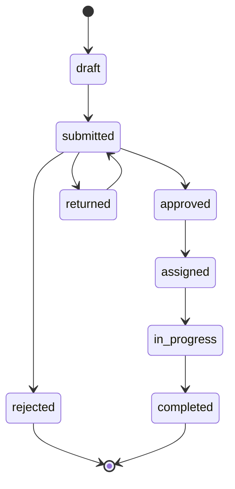

# Architecture

## MVC, plus one service

The app follows Laravel's MVC, with a few extra classes so that each rule has one home.

| Part | Classes | Responsibility |
|---|---|---|
| Model | `User`, `ServiceRequest`, `RequestComment`, `RequestActivity` | Relationships, casts, the role-based `visibleTo` scope |
| View | API Resources | The JSON shape. Resources only expose chosen fields, so nothing leaks by accident |
| Controller | `ServiceRequestController`, `ServiceRequestWorkflowController`, `AuthController`, ... | Receive, authorize, call one service method, return a Resource. No rules |
| Validation | Form Requests | Input rules, plus the policy check (so the order is 401, 403, then 422) |
| Authorization | `ServiceRequestPolicy` | **Who** may do an action |
| Workflow | `RequestStatus` enum, `RequestWorkflowService` | **Which** moves are legal, and doing them safely |
| Side effects | `RequestNotifier`, `RequestStatusChanged` | Who is told about a change, delivered through the queue |

## The status lifecycle

## Key decisions and trade-offs

1. **Transitions live in one enum.** `RequestStatus::allowedTransitions()` is the single source
   of truth, so no controller contains a transition `if`. A unit test checks all 64
   from/to pairs. Trade-off: the rules are code, not data, so changing them needs a deploy.
2. **A service performs every change.** `RequestWorkflowService::transition()` runs in one
   database transaction: it locks the row (`lockForUpdate`), validates the move, updates the
   status and timestamps, writes the audit row, and triggers notifications. The status and
   its history can never disagree, and two simultaneous decisions cannot both succeed.
3. **403 and 422 are deliberately separate.** Policies answer who, the workflow answers
   whether. Policies reuse the list scope (`visibleTo`), so "can see in the list" and "can
   open" can never disagree.
4. **Audit trail is an append-only table** with the actor, the from and to status, a comment,
   and a timestamp. Rows are never edited. History is ordered by `created_at` then `id`,
   because timestamps have one-second precision.
5. **Notifications are queued, after commit, through the database channel.** A worker can
   never pick up a notification for a change that was rolled back, and reviewers need no mail
   server. Trade-off: users must run a queue worker; email is one extra channel away.
6. **Uniform errors.** `bootstrap/app.php` renders every `/api` error as JSON with a
   `message`, even without an `Accept` header, and hides internals (for example, model names).
7. **Performance.** Lists use eager loading and pagination, a capped page size and a sort
   whitelist. Composite indexes match the list queries, and tests assert that query counts
   do not grow with the number of rows.
8. **API only, by design.** The brief asks for a backend for a client built by another team,
   so there is no front end. Interactive OpenAPI docs (Scramble) let reviewers try every
   endpoint in the browser.